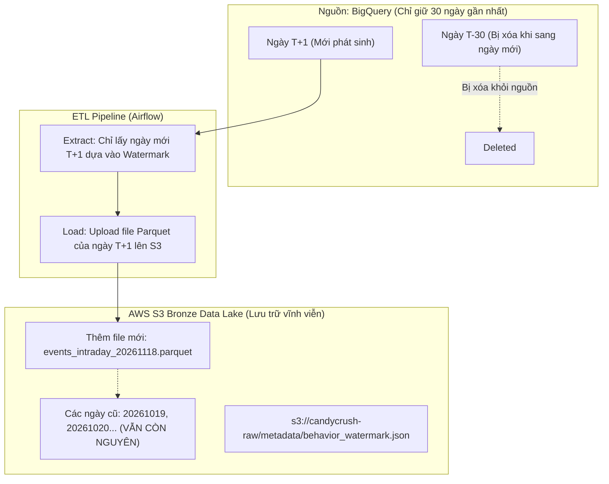

# Kiến Trúc Tối Ưu Hóa Customer Behavior: AWS S3 Bronze Data Lake & Redshift Silver

Tài liệu này giải thích chi tiết toàn bộ kiến trúc xử lý dữ liệu hành vi người dùng (**Customer Behavior - GA4 Events**), giải đáp câu hỏi về **vòng đời dữ liệu nguồn 30 ngày**, cơ chế **lưu trữ bảo toàn lịch sử trên AWS S3 Bronze**, và các điều chỉnh kỹ thuật đã thực hiện trong mã nguồn.

---

## 1. Giải đáp các thắc mắc cốt lõi

### 1.1. Tại sao đã đổi sang AWS S3 mà trong `Load_bronze.py` trước đó vẫn còn code BigQuery?
- **Nguyên nhân**: Ở phiên bản trước, hàm `load_all_to_bigquery` được giữ lại ở cuối file như một phương án dự phòng (fallback).
- **Hạn chế**: Do file `.env` đã gỡ bỏ hoàn toàn các biến BigQuery đích (`DST_PROJECT_ID`, `DST_DATASET_ID`), nếu hàm này bị gọi sẽ văng lỗi `KeyError: 'DST_PROJECT_ID'`. Đồng thời, việc để code BigQuery trong file load khiến luồng xử lý bị nhập nhằng, khó bảo trì.
- **Đã xử lý**: Đã xóa sạch 100% các đoạn code và import liên quan đến BigQuery trong [Load_bronze.py](file:///home/duong28/Documents/big-project-2/dags/customer_behavior/Load_bronze.py). Hiện tại, file này **chuyên trách 100% cho việc nạp dữ liệu lên AWS S3 Bronze Data Lake**.

---

### 1.2. Dữ liệu nguồn chỉ lưu 30 ngày: Làm thế nào để Bronze lưu dữ liệu mới mà KHÔNG làm mất dữ liệu cũ?

Đây là câu hỏi quan trọng nhất về kiến trúc Data Lakehouse (**Data Retention & History Preservation**).

#### A. Bản chất bài toán Rolling Retention 30 ngày:
- **Hệ thống nguồn (BigQuery GA4)**:
  - Nguồn GA4 lưu trữ dữ liệu theo cửa sổ trượt 30 ngày (**Rolling 30-day window**).
  - Hôm nay là ngày $T$, nguồn chỉ có dữ liệu từ ngày $T-30$ đến $T$.
  - Đến ngày $T+1$, nguồn tạo thêm ngày $T+1$ và **tự động xóa ngày $T-30$**.
- **Tầng Bronze trên AWS S3 (`s3://candycrush-raw/bronze-behavior/`)**:
  - Tầng Bronze đóng vai trò là **Cold Storage / Permanent Raw Archive** (Kho lưu trữ dữ liệu thô vĩnh viễn, bất biến - *Immutable Single Source of Truth*).
  - Dù nguồn BigQuery có xóa ngày cũ sau 30 ngày, thì trên AWS S3 Bronze: **Toàn bộ lịch sử từ ngày đầu tiên (ngày 1, 2... đến ngày 100, 365+) vẫn được giữ nguyên vẹn 100%**.

#### B. Cơ chế lưu trữ trên AWS S3 đảm bảo không mất dữ liệu cũ:



1. **Tính chất Append-Only của Object Storage (AWS S3)**:
   - Dữ liệu mỗi ngày được trích xuất thành một tệp Parquet độc lập:
     `events_intraday_20261019.parquet`
     `events_intraday_20261020.parquet`
     ...
     `events_intraday_20261118.parquet`
   - Khi hàm `s3_client.upload_file()` tải file của ngày mới lên S3, nó **chỉ tạo thêm một Object mới**. S3 **tuyệt đối không bao giờ tự xóa** các file của các ngày cũ trước đó.
   - Code của chúng ta không sử dụng bất kỳ lệnh `delete_object` nào trên dữ liệu, đảm bảo tính chất **Append-Only**.

2. **Cơ chế Watermark không bị ảnh hưởng bởi việc xóa dữ liệu nguồn**:
   - File `metadata/behavior_watermark.json` trên S3 lưu mốc `MAX(event_timestamp)` lớn nhất đã từng nạp thành công lên Bronze.
   - Khi nguồn xóa các ngày cũ ($T-30$), giá trị Watermark trên S3 vẫn đang ở mốc của ngày mới nhất ($T$).
   - Câu truy vấn trích xuất: `WHERE event_timestamp > {watermark}` sẽ chỉ quét những sự kiện có timestamp lớn hơn watermark. Việc nguồn xóa các bản ghi cũ ở phía sau **hoàn toàn không ảnh hưởng** đến việc trích xuất ngày mới.

3. **Hỗ trợ chạy theo ngày chỉ định (`run_date`) để Backfill / Rerun linh hoạt**:
   - Khi Airflow chạy tự động hàng ngày lúc 06:00 sáng: Tham số `run_date` mặc định là ngày hôm trước ($T-1$). Pipeline chỉ nạp đúng ngày hôm trước.
   - Khi bạn muốn **chạy bù (Backfill)** hoặc **chạy lại** một ngày bất kỳ trong vòng 30 ngày qua (ví dụ ngày `20261025` bị lỗi), bạn chỉ cần gõ `run_date = 20261025` trên giao diện Airflow Trigger. Pipeline sẽ chỉ trích xuất và nạp đúng ngày đó mà không ảnh hưởng tới dữ liệu của 29 ngày còn lại!

---

## 2. Các điểm tối ưu kỹ thuật quan trọng vừa hoàn thiện

### 2.1. Tách file Metadata ra khỏi thư mục chứa Parquet
- **Vấn đề**: Trước đây file `_watermark.json` nằm chung trong thư mục `s3://candycrush-raw/bronze-behavior/`.
- **Rủi ro**: Khi Amazon Redshift Spectrum hoặc Athena truy vấn bảng ngoài (`spectrum_db.bronze_events`) trỏ vào `bronze-behavior/`, hệ thống đọc tất cả file trong folder. Khi gặp file `.json`, Redshift Spectrum sẽ báo lỗi: `Invalid Parquet file: magic bytes not found`.
- **Giải pháp**: Đã chuyển vị trí lưu watermark sang:
  `s3://candycrush-raw/metadata/behavior_watermark.json`
  Giúp thư mục `bronze-behavior/` **100% chỉ chứa các file dữ liệu chuẩn Parquet**.

### 2.2. Sửa lỗi thay thế chuỗi làm hỏng câu lệnh Redshift SQL
- **Vấn đề**: Trong [etl_behavior.py](file:///home/duong28/Documents/big-project-2/dags/etl_behavior.py), câu lệnh `sql_query.replace("YYYYMMDD", run_date)` đã thay thế nhầm format date string trong câu SQL:
  `TO_DATE(e.event_date, 'YYYYMMDD')` $\longrightarrow$ `TO_DATE(e.event_date, '20261118')`
  Làm Redshift văng lỗi cú pháp ngày tháng (`Invalid date format string`).
- **Giải pháp**: Đã điều chỉnh để chỉ thay thế placeholder `{{ run_date }}` hoặc format chuẩn, bảo toàn nguyên vẹn hàm `TO_DATE(..., 'YYYYMMDD')`.

### 2.3. Sửa đường dẫn `SQL_DIR`
- **Vấn đề**: `SQL_DIR = os.path.join(BASE_DIR, "sql")` tìm thư mục `/opt/airflow/sql` không tồn tại, khiến task Silver bị lỗi `FileNotFoundError`.
- **Giải pháp**: Đã sửa thành `SQL_DIR = os.path.join(DAGS_DIR, "sql")` trỏ chính xác đến [dags/sql/silver-behavior-flat-event.sql](file:///home/duong28/Documents/big-project-2/dags/sql/silver-behavior-flat-event.sql).

---

## 3. Kiến trúc luồng tổng thể 3 tầng (End-to-End Medallion)

```
[BigQuery Source (US)] 
       │  (Rolling 30 days)
       ▼
[Airflow Extract Task] (Storage Read API gRPC, 13s/bảng)
       │
       ▼
[Local Landing Zone] (data/ga4/*.parquet)
       │
       ▼
[Airflow Load Bronze Task] (boto3 upload & S3 metadata watermark)
       │
       ▼
[AWS S3 Bronze Data Lake] (s3://candycrush-raw/bronze-behavior/ - LƯU VĨNH VIỄN)
       │
       ▼
[Amazon Redshift Spectrum] (spectrum_db.bronze_events)
       │  (silver-behavior-flat-event.sql làm phẳng 265 cột)
       ▼
[Amazon Redshift Silver] (dev.flat_events)
```

---

## 4. Hướng dẫn vận hành

### 4.1. Chạy tự động hàng ngày
Airflow DAG `customer_behavior_etl` tự động chạy lúc **06:00 AM** mỗi ngày:
1. `resolve_run_date`: Lấy ngày hôm trước ($T-1$).
2. `extract_ga4_events`: Đọc từ BigQuery nguồn và ghi ra file Parquet.
3. `load_ga4_to_bronze`: Đẩy file Parquet lên AWS S3 và cập nhật watermark tại `metadata/behavior_watermark.json`.
4. `load_ga4_to_silver`: Thực thi script làm phẳng dữ liệu trên Amazon Redshift.

### 4.2. Chạy bù ngày cụ thể (Backfill)
Trên giao diện **Airflow Web UI** (`http://localhost:8080`):
1. Bấm nút **Trigger DAG with config** (nút Play có bánh răng).
2. Nhập ngày cần chạy vào ô `run_date` dạng `YYYYMMDD` (ví dụ: `20261110`).
3. Bấm **Trigger**. Hệ thống sẽ trích xuất và nạp chuẩn xác cho riêng ngày `20261110` mà không ảnh hưởng tới dữ liệu các ngày khác!
