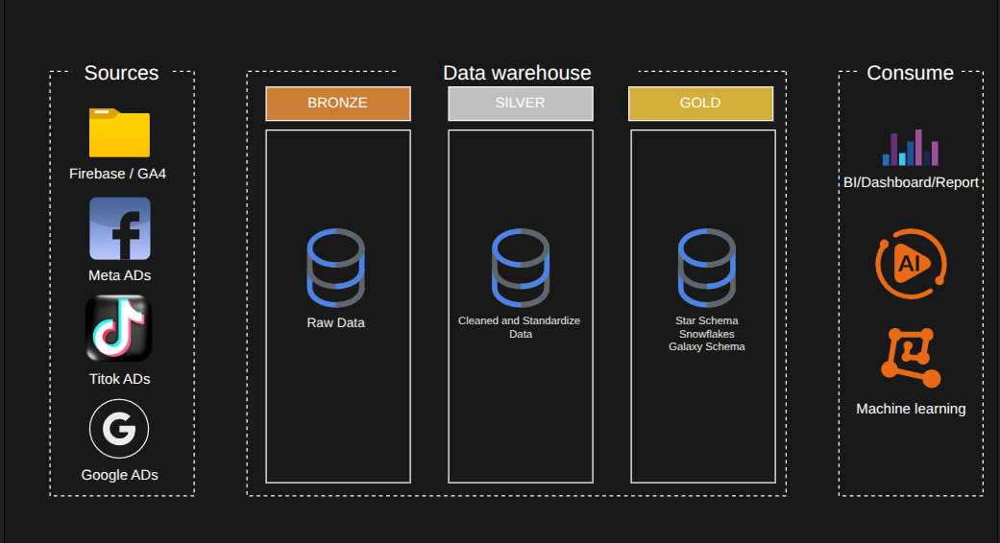

# King Studio Data Platform: Marketing & User Behavior

## 1. Bối cảnh

**King Studio** là studio mobile game vận hành 10 game (Candy Crush Saga, Soda Saga, Pet Rescue Saga, Farm Heroes Saga, Blossom Blast Saga, Bubble Witch 3 Saga, Diamond Diaries Saga, Jelly Saga, Solitaire, Friends Saga).

Công ty có 2 nguồn dữ liệu chính, đang nằm rời rạc:

- **Marketing (User Acquisition):** mỗi ngày đội UA tiêu tiền quảng cáo trên Facebook Ads, TikTok Ads, Google Ads cho 10 game ở 14 quốc gia. Họ phải vào từng Ads Manager để xem chi phí, installs, CPI, ROAS.
- **Hành vi người dùng (Product Analytics):** game gửi event qua Firebase / GA4 (`first_open`, `session_start`, `level_start`, `level_end`, `in_app_purchase`, `ad_impression`...). Dữ liệu nằm trong bảng GA4 export dạng nested nên người làm phân tích không truy vấn trực tiếp được.

**Vai trò của mình:** Data Engineer của đội Data Platform. Xây hệ thống ETL chạy tự động hằng ngày, gom 2 nguồn về BigQuery và chuẩn hoá thành các bảng sạch để các đội dùng chung.

## 2. Kiến trúc tổng quan

## 3. Output

Dữ liệu được lưu trên **BigQuery** theo 3 tầng Medallion, cập nhật mỗi ngày, sẵn sàng trước 08:30 sáng.

| Tầng | Nội dung |
|---|---|
| **Bronze (raw)** | Dữ liệu thô từ Meta / TikTok / Google Ads API (JSON) và bảng event GA4 đã flatten |
| **Silver (clean)** | Dữ liệu đã chuẩn hoá: quy đổi USD, dedup, ép kiểu, ghi idempotent bằng staging + MERGE. Ads gộp về 1 bảng `ads_unified`, event tách theo loại (`first_open`, `level_end`, `in_app_purchase`...) |
| **Gold (mart)** | Bảng phục vụ phân tích: `ua_roas_daily` (chi phí, installs, CPI, ROAS theo game / nền tảng / quốc gia / campaign), `user_daily` (hành vi theo ngày), `cost_monitoring` |

Các bảng Marketing có 3 cấp chi tiết: `fact_campaign`, `fact_adset`, `fact_ad` (mỗi dòng = 1 đối tượng, 1 ngày).

Ngoài dữ liệu, hệ thống còn có: lịch chạy tự động (Airflow), kiểm tra chất lượng dữ liệu, đối soát với Ads Manager và nhật ký vận hành 7 ngày.

## 4. Tech stack

| Lớp | Công nghệ |
|---|---|
| Nguồn dữ liệu | Meta Ads API, TikTok Ads API, Google Ads API, Firebase / GA4 export |
| Orchestration | Apache Airflow 3 (Celery Executor, Redis, Postgres) |
| Hạ tầng | GCP Compute Engine, Docker, Docker Compose |
| Data Warehouse | Google BigQuery |
| Ngôn ngữ | Python, SQL |
| CI/CD | GitHub, GitHub Actions |